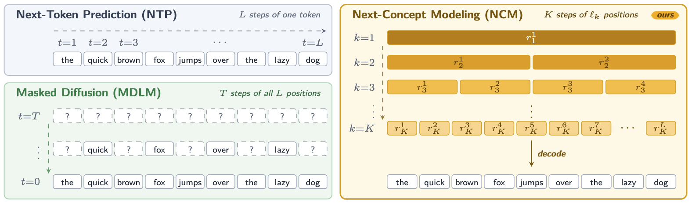

```{r setup}
suppressPackageStartupMessages({
  library(knitr)
  library(kableExtra)
  library(ggplot2)
  library(dplyr)
  library(tidyr)
  library(readr)
  library(jsonlite)
  library(scales)
  library(patchwork)
})

knitr::opts_chunk$set(comment = "", fig.align = "center")

theme_set(
  theme_minimal(base_size = 10) +
    theme(
      panel.grid.minor = element_blank(),
      plot.title = element_text(face = "bold", size = 10),
      plot.subtitle = element_text(size = 9, colour = "grey35"),
      legend.position = "bottom",
      legend.title = element_blank(),
      plot.caption = element_text(size = 8, colour = "grey35", hjust = 0)
    )
)

pal <- c(
  blue = "#2b6cb0",
  orange = "#dd6b20",
  teal = "#2c7a7b",
  red = "#c53030",
  grey = "#718096"
)

read_json <- function(path) jsonlite::fromJSON(path, simplifyVector = FALSE)

base_splits <- dplyr::bind_rows(lapply(c("train", "validation", "test"), function(s) {
  x <- read_json(sprintf("data/base_%s_summary.json", s))
  data.frame(
    split = s,
    games = length(x$games),
    examples = x$examples,
    raw = x$raw_examples,
    duplicates = x$duplicates,
    moves = x$actions$m,
    attacks = x$actions$a,
    builds = x$actions$b,
    captures = x$actions$c,
    stringsAsFactors = FALSE
  )
})) |>
  dplyr::mutate(split = factor(split, levels = c("train", "validation", "test")))

base_actions <- base_splits |>
  dplyr::filter(split == "train") |>
  dplyr::select(moves, attacks, builds, captures) |>
  tidyr::pivot_longer(everything(), names_to = "action", values_to = "n") |>
  dplyr::mutate(
    action = factor(
      action,
      levels = c("moves", "attacks", "builds", "captures"),
      labels = c("Move", "Attack", "Build", "Capture")
    ),
    share = n / sum(n)
  )

prefix_raw <- read_json("data/prefix_lengths.json")
prefix_df <- dplyr::bind_rows(lapply(names(prefix_raw), function(p) {
  data.frame(
    persona = p,
    n = prefix_raw[[p]]$n,
    mean = prefix_raw[[p]]$mean,
    p95 = prefix_raw[[p]]$p95,
    max = prefix_raw[[p]]$max,
    over832 = prefix_raw[[p]]$over_832,
    stringsAsFactors = FALSE
  )
}))

persona_names <- c("aggressive", "defensive", "infantry", "armor", "artillery")
persona_doctrine <- c(
  aggressive = "Blitz: attack first, push the enemy HQ",
  defensive = "Anvil: hold the line around the HQ",
  infantry = "Line: mass infantry and take ground",
  armor = "Vanguard: mass tanks and hunt vehicles",
  artillery = "Siege: bombard from range behind a screen"
)

persona_rows <- dplyr::bind_rows(lapply(persona_names, function(p) {
  tr <- read_json(sprintf("data/personas/%s-train.json", p))
  va <- read_json(sprintf("data/personas/%s-validation.json", p))
  te <- read_json(sprintf("data/personas/%s-test.json", p))
  data.frame(
    persona = p,
    doctrine = persona_doctrine[[p]],
    games = tr$games,
    train = tr$rows,
    validation = va$rows,
    test = te$rows,
    stringsAsFactors = FALSE
  )
}))

league_raw <- read_json("data/persona_league.json")
league_df <- dplyr::bind_rows(lapply(names(league_raw$aggregates), function(p) {
  a <- league_raw$aggregates[[p]]
  data.frame(
    persona = p,
    fallback = a$fallback_rate,
    generated = a$generated_share,
    repaired = a$repaired_share,
    model = a$model_share,
    score = a$avg_score_delta,
    stringsAsFactors = FALSE
  )
}))

metric_lines <- readLines("data/infantry_e8_metrics.jsonl", warn = FALSE)
metric_recs <- lapply(metric_lines, function(line) jsonlite::fromJSON(line, simplifyVector = FALSE))
epochs <- dplyr::bind_rows(lapply(metric_recs, function(m) {
  if (!identical(m$kind, "epoch")) return(NULL)
  data.frame(
    epoch = m$epoch,
    loss = m$loss,
    val_loss = m$val_loss,
    exact = m$exact,
    parseable = m$parseable,
    stringsAsFactors = FALSE
  )
}))

vs_raw <- read_json("data/vs_ncm_run1.json")
vs_iter <- vs_raw$iterations[[1]]

nice_table <- function(df, align = "l", font_size = 9, scale = FALSE) {
  opts <- c("HOLD_position")
  if (scale) opts <- c(opts, "scale_down")
  kableExtra::kbl(
    df,
    format = "latex",
    booktabs = TRUE,
    linesep = "",
    align = align
  ) |>
    kableExtra::kable_styling(latex_options = opts, font_size = font_size)
}
```

# Executive summary

This report reconstructs how the NCM player in `C:\AIs\NCM\tbs_ncm` is trained. It covers the game-specific data pipeline, the character-level order tokenizer, the next-concept generator, the stepwise inference loop, and the later persona, DAgger, and self-play experiments.

The short version: the NCM is not a reward-driven agent. It is a **two-stage supervised model** that imitates the orders produced by scripted policies. A multiscale VQ-VAE compresses a single order line into a hierarchy of discrete codes, and a transformer predicts that hierarchy coarse-to-fine from a compact text description of the board. At play time, the model emits one order per step; a legalizer repairs or rejects samples and a scripted fallback finishes the turn when the model cannot produce a legal order.

```{r}
at_a_glance <- data.frame(
  Item = c(
    "Order tokenizer",
    "Generator",
    "Base training data",
    "Validation / test data",
    "Tokenizer reconstruction",
    "Generator exact match",
    "Generator parseable",
    "Inference cost",
    "Matches"
  ),
  Value = c(
    "9-level VQ-VAE, 4,096 codes per level",
    "8 layers, 8 heads, 512 wide, 53M parameters",
    "54,525 rows from 200 games",
    "5,274 / 5,425 rows",
    "100% exact on 5,274 held-out orders",
    "35.9% on 128 states; 25.2% on 500 states",
    "100% on 128 states; 99.4% on 500 states",
    "about 60 ms per order on an RTX 5070 Ti",
    "beat greedy and a local 74B LLM"
  ),
  stringsAsFactors = FALSE
)
nice_table(at_a_glance, align = c("l", "p{11.2cm}"), font_size = 9)
```

Two cautions frame the rest of the report. First, the base model was trained on one scenario, `border_skirmish`, with a greedy teacher; the training data therefore contains moves, attacks, builds, and captures, but no loads, unloads, or holds. Second, exact order reproduction is not the same as winning: the legalizer and the fallback policy are part of the deployed player, and their share of orders must be reported alongside the model's exact-match rate.

# The game loop and why NCM fits

A turn-based strategy turn is a sequence of small decisions. The engine exposes a view of the board, the acting player chooses one legal order, the engine applies it, and the next view is built. The NCM receives the compact text form of that view and returns one order line. The coordinator validates the order and asks again with a fresh view; the turn ends when no unit can act and the coordinator submits `end_turn`.

The order format is deliberately small. A move is `m A2 3,4`; an attack is `a A5 B5 howitzer`; a build is `b 1,1 infantry`; a capture is `c A4`. This is a closed alphabet of mnemonics, unit ids, coordinates, digits, spaces, commas, and a few punctuation characters.

```
#ncm1 A t3
players
A 17300 +3100 8
B 20400 +3100 8
units
A1 hq 0,2 100 - mg:20
A2 infantry 4,3 20 - rifle:10 !>
B3 infantry 6,3 4 - rifle:9
builds
1,1 infantry 700
```

The codec is lossy on purpose. It keeps the facts that change the decision — turn, player, funds, sites, units, HP, ammo, and affordable builds — and drops static specification data and the engine's full `unit_actions` lists. A state costs roughly 500 GPT-2 tokens instead of 3,800–4,700 for the full JSON view. The trade-off is that the model does not see the legal action set; legality is enforced outside the model.

```{mermaid}
%%| label: fig-agent-loop
%%| fig-cap: "The deployed loop. The model sees one compact state, emits one order, and receives a fresh state after the engine accepts it."
%%| fig-width: 6.4
%%| fig-height: 4.8
flowchart TB
  E["Game engine<br/>authoritative state"] --> C["Compact codec<br/>state text"]
  C --> N["NCM<br/>one order per step"]
  N --> L["Legalizer<br/>exact / repair / resample"]
  L -->|accepted| E
  L -->|rejected or unparseable| N
  L -->|no legal sample| G["Scripted fallback<br/>greedy or persona"]
  G --> E
```

# What Next-Concept Modeling is

Next-Concept Modeling (NCM) is a two-stage generative framework. The first stage turns a sequence into a hierarchy of discrete codes at several resolutions. The second stage predicts that hierarchy from coarse to fine, generating all positions of a level in parallel. For a 28-character order, the model performs one forward evaluation per level instead of one per character.

{#fig-overview width=98%}

```{mermaid}
%%| label: fig-two-stage
%%| fig-cap: "The two stages used here. The tokenizer is trained first on order lines and then frozen. The generator learns to predict the tokenizer's code hierarchy from the state prefix."
%%| fig-width: 6.4
%%| fig-height: 6.4
flowchart TB
  subgraph T["Stage 1: order tokenizer"]
    O["Order line<br/>28 characters"] --> CH["Character tokens"]
    CH --> VE["VQ-VAE encoder"]
    VE --> VQ["9 residual code levels"]
    VQ --> VD["VQ-VAE decoder"]
    VD --> OR["Reconstructed order"]
  end
  subgraph G["Stage 2: NCM generator"]
    S["State text"] --> BPE["GPT-2 BPE ids"]
    BPE --> PE["Prefix embedding<br/>832 tokens"]
    PE --> TR["8 transformer blocks"]
    Q["Learned level-0 query"] --> TR
    TR --> H["9 level heads"]
    H --> CO["Code hierarchy<br/>1 + 2 + ... + 28 codes"]
  end
  VQ -.->|frozen codebook| CO
  CO -.->|decode| VD
```

## The coarse-to-fine code hierarchy

The tokenizer uses nine manual levels with widths `[1, 2, 3, 4, 6, 8, 12, 16, 28]`. The last level has one code per character. The earlier levels are shorter, coarser descriptions of the same 28-character sequence. The generator predicts level 0 from a learned query chunk, then conditions each later level on the prefix and on the already generated coarser levels.

The widths are not arbitrary. The hierarchy starts with a single summary slot, grows through 2, 3, 4, 6, 8, 12, and 16 positions, and ends with 28 positions — one per character. The coarse levels give the model a short target to get right first; the fine levels carry the exact spelling. Because each level is predicted in parallel, decoding costs nine forward passes, not twenty-eight.

```{r}
#| label: fig-levels
#| fig-cap: "The nine code levels for one order. The finest level has 28 positions, one per character; higher levels are shorter, coarser representations. Each level is produced in one parallel pass."
#| fig-width: 6.4
#| fig-height: 4.2
level_widths <- c(1, 2, 3, 4, 6, 8, 12, 16, 28)
level_labels <- sprintf("Level %d  (%d codes)", 1:9, level_widths)
level_df <- dplyr::bind_rows(lapply(seq_along(level_widths), function(i) {
  data.frame(level = i, width = level_widths[i], pos = seq_len(level_widths[i]))
})) |>
  dplyr::mutate(
    level_label = factor(
      sprintf("Level %d  (%d codes)", level, width),
      levels = rev(level_labels)
    )
  )

ggplot(level_df, aes(x = pos, y = level_label)) +
  geom_tile(aes(fill = factor(level)), width = 0.92, height = 0.72, colour = "white") +
  geom_text(aes(label = pos), size = 2.1, colour = "white") +
  scale_fill_manual(values = colorRampPalette(c("#c6dbef", "#2b6cb0"))(9), guide = "none") +
  scale_x_continuous(breaks = 1:28, expand = c(0, 0)) +
  labs(
    x = "Code position inside the level",
    y = NULL,
    title = "Coarse-to-fine codes for one 28-character order",
    subtitle = "The model makes one parallel prediction per level, not one per character."
  ) +
  theme(
    panel.grid = element_blank(),
    axis.text.x = element_text(size = 7),
    axis.text.y = element_text(size = 8)
  )
```

The residual quantizer is what makes the hierarchy work. At level $k$, the current residual $r_k$ is quantized to the nearest entry $e_{k,c_k}$ of that level's codebook. The quantized vector is upsampled to the finest resolution, added to the reconstruction, and subtracted from the residual:

$$
c_k = \arg\min_j \lVert r_k - e_{k,j} \rVert_2^2,
\qquad
\hat z = \sum_{k=1}^{9} \operatorname{up}_k(e_{k,c_k}),
\qquad
r_{k+1} = r_k - \operatorname{up}_k(e_{k,c_k}).
$$

Each level therefore refines what the previous levels could not represent. The codebooks are updated with exponential moving averages, not gradients; the VQ commitment term is part of the tokenizer loss.

## Why a character tokenizer

The released XSum tokenizer cannot represent order lines. Round-tripping `m A2 3,4` through it produces `A A2 3,4.`, and `u A6 A2 2,3` becomes `A A6 A2 2,33 in`. Orders are a tiny closed alphabet, so the target side uses a character tokenizer: 67 printable symbols plus PAD and EOS. Exact reconstruction is then a meaningful gate: a player that cannot spell an order cannot play.

# The model configuration

```{r}
#| label: tbl-config
#| tbl-cap: "Configuration of the tokenizer and generator used for the base model."
config_table <- data.frame(
  Component = c(
    "Order tokenizer",
    "Tokenizer input",
    "Code levels",
    "Codes per level",
    "VQ-VAE encoder",
    "VQ-VAE decoder",
    "Generator",
    "Prefix",
    "Context length",
    "Target sequence",
    "Attention",
    "Position encoding",
    "Output heads"
  ),
  Setting = c(
    "multiscale residual VQ-VAE",
    "character-level, 67 symbols + PAD/EOS",
    "9 levels: 1, 2, 3, 4, 6, 8, 12, 16, 28",
    "4,096",
    "6 layers, 384-d, GroupNorm before quantization",
    "2 layers, context 28",
    "8 layers, 8 heads, 512-d, dropout 0.1 (~53M parameters)",
    "832 GPT-2 BPE tokens during training; 2,048 at inference",
    "912 = 832 prefix + 80 code positions",
    "80 codes (1 learned query + 79 hierarchical codes)",
    "block-diagonal: prefix sees prefix; target sees prefix and same level",
    "RoPE, with each target level restarting at position 0",
    "9 heads tied to the VQ codebooks, with learned inverse temperature"
  ),
  stringsAsFactors = FALSE
)
nice_table(config_table, align = c("l", "p{10.8cm}"), font_size = 8.5)
```

A subtle but important detail: the generator does not run a pretrained GPT-2 transformer over the state. The state is tokenized with GPT-2 BPE, but the `ctx_encoder` in this configuration has `n_layer: 0`; it is a learned embedding of GPT-2 token ids. The 8 transformer blocks in the generator operate over the concatenation of that prefix embedding and the code hierarchy. That keeps the state vocabulary separate from the tokenizer's character vocabulary.

# Data: how the training set was built

The base dataset is generated by playing the game, not by recording human games. `generate_data.py` uses the engine's greedy agent with two sources of variation: a 30% chance to build at a free site, and a 12% chance to replace a chosen move with another legal destination. Games run for at most 40 rounds. Every accepted order becomes one row containing the compact state prefix and the canonical order line; duplicate `(prefix, target)` rows are removed.

Each row is one decision, not a whole turn. A single game contributes many rows, one per accepted order, and the prefix is rebuilt from the view at that step. The validation and test splits use disjoint seed ranges, so no game appears in two splits.

```{r}
#| label: tbl-splits
#| tbl-cap: "Base dataset. Seeds are disjoint: 1–200 for training, 10,000–10,019 for validation, and 20,000–20,019 for test."
splits_table <- base_splits |>
  dplyr::transmute(
    Split = as.character(split),
    Seeds = c("1–200", "10,000–10,019", "20,000–20,019")[match(split, c("train", "validation", "test"))],
    Games = games,
    Rows = examples,
    Moves = moves,
    Attacks = attacks,
    Builds = builds,
    Captures = captures
  )
nice_table(splits_table, align = "lrrrrrrr", font_size = 8.5)
```

```{mermaid}
%%| label: fig-data-loop
%%| fig-cap: "The base data-generation loop. The teacher is the greedy agent, with occasional builds and move noise. Only orders accepted by the engine become training rows."
%%| fig-width: 6.4
%%| fig-height: 5.0
flowchart TB
  A["Scenario + seed"] --> B["Greedy agent"]
  B --> C{"Build or move noise?"}
  C -->|30% build| D["Build at an affordable site"]
  C -->|12% move noise| E["Different legal destination"]
  C -->|otherwise| F["Keep the greedy order"]
  D --> G["Submit one order"]
  E --> G
  F --> G
  G --> H{"Engine accepts?"}
  H -->|no| B
  H -->|yes| I["Encode state + order<br/>append JSONL row"]
  I --> J{"Turn cap or game over?"}
  J -->|no| B
  J -->|yes| K["Deduplicate and split"]
```

```{r}
#| label: fig-actions
#| fig-cap: "Action mix in the base training split. The greedy teacher never loads, unloads, or holds, so those actions are absent from the base data; the persona data later adds them."
#| fig-width: 6.4
#| fig-height: 2.8
ggplot(base_actions, aes(x = reorder(action, n), y = n, fill = action)) +
  geom_col(width = 0.68, show.legend = FALSE) +
  geom_text(aes(label = paste0(comma(n), "  (", percent(share, accuracy = 0.1), ")")),
            hjust = -0.08, size = 3.1, colour = "grey20") +
  scale_fill_manual(values = c(Move = pal[["blue"]], Attack = pal[["orange"]],
                               Build = pal[["teal"]], Capture = pal[["red"]])) +
  scale_y_continuous(labels = comma, expand = expansion(mult = c(0, 0.22))) +
  coord_flip(clip = "off") +
  labs(
    x = NULL,
    y = "Training rows",
    title = "The base dataset is dominated by movement and attacks",
    subtitle = "Builds are 14.3% of rows; captures are 6.3%. Load, unload, and hold are absent."
  ) +
  theme(panel.grid.major.y = element_blank())
```

## State length and the 832/2,048 prefix question

The base run trained with `prefix_len: 832`. The measured prefixes are mostly shorter: the training mean is 521 GPT-2 tokens, the 95th percentile is 682, and the maximum is 870. Only 13 of 54,525 training rows exceed 832; they are skipped at training time. Validation and test never exceed 832 in this dataset.

```{r}
#| label: fig-prefix-base
#| fig-cap: "Base state-prefix lengths. The distribution stays near 500 tokens, with a small tail above the 832-token training limit."
#| fig-width: 6.2
#| fig-height: 2.6
base_prefix <- readr::read_csv("data/base_prefix_lengths.csv", show_col_types = FALSE) |>
  dplyr::mutate(split = factor(split, levels = c("train", "validation", "test")))

ggplot(base_prefix, aes(x = tokens, colour = split, fill = split)) +
  geom_density(alpha = 0.16, linewidth = 0.55, adjust = 1.15) +
  geom_vline(xintercept = 832, linetype = "dashed", colour = pal[["red"]], linewidth = 0.6) +
  scale_x_continuous(limits = c(0, 900), breaks = seq(0, 800, 200)) +
  scale_colour_manual(values = c(train = pal[["blue"]], validation = pal[["teal"]], test = pal[["orange"]])) +
  scale_fill_manual(values = c(train = pal[["blue"]], validation = pal[["teal"]], test = pal[["orange"]])) +
  labs(
    x = "GPT-2 tokens in the state prefix",
    y = "Density",
    title = "Base data (border_skirmish)",
    subtitle = "Dashed line: 832-token training limit"
  )
```

That picture changes for the persona data. Late-game persona states reach 1,814 tokens, and 9–29% of persona test rows exceed 832 depending on the doctrine. The generator uses RoPE, so the same weights can run with a longer prefix; inference therefore defaults to 2,048, and persona fine-tunes use `--prefix-len 2048`.

```{r}
#| label: fig-prefix-persona
#| fig-cap: "Persona state-prefix lengths by doctrine. Late-game states reach far beyond the 832-token training limit; the 2,048 inference limit covers the measured maximum."
#| fig-width: 6.2
#| fig-height: 3.2
prefix_long <- prefix_df |>
  dplyr::select(persona, mean, p95, max) |>
  tidyr::pivot_longer(-persona, names_to = "statistic", values_to = "tokens") |>
  dplyr::mutate(
    statistic = factor(statistic, levels = c("mean", "p95", "max"),
                       labels = c("mean", "95th percentile", "maximum"))
  )

ggplot(prefix_long, aes(x = tokens, y = reorder(persona, tokens), colour = statistic, shape = statistic)) +
  geom_point(size = 2.4) +
  geom_vline(xintercept = 832, linetype = "dashed", colour = pal[["red"]], linewidth = 0.6) +
  geom_vline(xintercept = 2048, linetype = "dotted", colour = "grey35", linewidth = 0.6) +
  scale_x_continuous(limits = c(0, 2100), breaks = c(0, 500, 1000, 1500, 2000)) +
  scale_y_discrete(limits = rev(persona_names)) +
  scale_colour_manual(values = c(mean = pal[["blue"]], `95th percentile` = pal[["teal"]], maximum = pal[["orange"]])) +
  labs(
    x = "GPT-2 tokens in the state prefix",
    y = NULL,
    title = "Persona test data (five maps)",
    subtitle = "Dashed: 832; dotted: 2,048 inference limit"
  )
```

## Persona data

A persona is not a prompt or a separate model head. It is a scripted decision policy used to label data. `persona_data.py` plays two personas against each other on five maps, records both sides, and writes one dataset per persona. The teachers differ in build preferences, target choice, risk tolerance, and how far they are willing to leave home. Holds are capped at 30% so a defensive mirror cannot teach a clone to pass for most of the game.

```{r}
#| label: tbl-persona-data
#| tbl-cap: "Persona datasets. Each persona has its own train/validation/test split and its own fine-tuned checkpoint; all personas share the base tokenizer."
persona_table <- persona_rows |>
  dplyr::transmute(
    Persona = persona,
    Doctrine = doctrine,
    Train = train,
    Validation = validation,
    Test = test,
    Games = games
  )
nice_table(persona_table, align = c("l", "p{6.2cm}", "r", "r", "r", "r"), font_size = 8.5)
```

# Stage 1: training the order tokenizer

The tokenizer is trained only on the target side. Each order line is encoded as characters, padded or truncated to 28 positions, and passed through the VQ-VAE. The loss is reconstruction cross-entropy plus the vector-quantizer term. The optimizer is AdamW with a cosine schedule, a short warmup, gradient clipping, and a batch size of 64.

The tokenizer is trained first and then frozen for the generator. Its job is narrower than a general text tokenizer: it only has to reconstruct one order line, but it must do so exactly. The validation gate is therefore exact string reconstruction, not a token-level likelihood; a single wrong coordinate or unit id makes the order unusable.

```{r}
#| label: tbl-tokenizer
#| tbl-cap: "Tokenizer training settings and the measured gate."
tok_table <- data.frame(
  Setting = c(
    "Input / context",
    "Vocabulary",
    "Code levels",
    "Codes per level",
    "Encoder / decoder",
    "Batch size",
    "Optimizer / learning rate",
    "Schedule",
    "Default epochs",
    "Early stop",
    "Validation result"
  ),
  Value = c(
    "one order line, 28 characters including EOS",
    "67 printable symbols + PAD + EOS",
    "9: 1, 2, 3, 4, 6, 8, 12, 16, 28",
    "4,096 per level",
    "6 encoder layers at 384-d; 2 decoder layers",
    "64",
    "AdamW, 3e-4, betas 0.9/0.95, weight decay 0.01",
    "cosine decay with 100-step warmup; gradient clip 1.0",
    "25 in the documented command; it stopped after 4 epochs",
    "stop when validation reconstruction is 100% exact",
    "100% exact on all 5,274 held-out orders"
  ),
  stringsAsFactors = FALSE
)
nice_table(tok_table, align = c("l", "p{10.6cm}"), font_size = 8.5)
```

During training the tokenizer also tracks active codes and perplexity per level. A collapsed level — one where nearly every input maps to the same code — is visible as a single bar in the dashboard, and the codebook-health panel is the first diagnostic to check before blaming the generator.

```{mermaid}
%%| label: fig-tokenizer-loop
%%| fig-cap: "Tokenizer training. The model sees only order lines; the board state is not reconstructed. The gate is exact reconstruction of held-out orders."
%%| fig-width: 6.4
%%| fig-height: 5.6
flowchart TB
  A["Order line<br/>m A2 3,4"] --> B["Character tokenizer<br/>67 symbols + PAD/EOS"]
  B --> C["VQ-VAE encoder<br/>6 layers, 384-d"]
  C --> D["9 residual quantizers<br/>4,096 codes each"]
  D --> E["VQ-VAE decoder<br/>2 layers"]
  E --> F["Reconstructed order"]
  F --> G["Cross-entropy + VQ commitment"]
  G --> H["AdamW + cosine schedule"]
  H -.->|next batch| C
```

The 100% reconstruction gate is the reason the rest of the pipeline can treat orders as discrete symbols. The generator never needs to produce characters directly; it predicts codes from a codebook that has already proven it can reconstruct the target lines exactly.

# Stage 2: training the generator

The generator is trained with teacher forcing. A state prefix is tokenized with GPT-2 BPE and embedded. The target order is encoded by the frozen tokenizer into 80 codes. The model receives the prefix, a learned level-0 query chunk, and the target hierarchy shifted in the same way as a causal language model, and predicts the code at every position. One forward pass covers all 80 positions; the attention mask makes positions within a level mutually visible and blocks attention across levels.

The loss is cross-entropy over all 80 code positions. The model uses bf16 autocast, AdamW, a cosine schedule, gradient clipping, and an effective batch of 16 (batch size 8 with two gradient-accumulation steps).

The target is the 80-code hierarchy, not the 28 characters. The level-0 query is a learned chunk, and the eight later levels are conditioned on the prefix and the coarser codes. The block-diagonal mask is what allows all positions of a level to be predicted in one pass: positions in the same level see each other, while a level cannot see a finer level that has not been generated yet.

```{mermaid}
%%| label: fig-generator-loop
%%| fig-cap: "Generator training. The prefix comes from the state; the target codes come from the frozen tokenizer. Validation measures both teacher-forced loss and free-running order quality."
%%| fig-width: 6.4
%%| fig-height: 6.6
flowchart TB
  S["State text"] --> B["GPT-2 BPE ids"]
  B --> P["Prefix embedding<br/>832 positions"]
  O["Order line"] --> C["Character tokenizer"]
  C --> V["Frozen VQ-VAE encode"]
  V --> H["Code hierarchy<br/>80 positions"]
  P --> T["NCM transformer<br/>8 layers x 8 heads x 512"]
  H --> T
  T --> L["9 level heads<br/>codebook-tied logits"]
  L --> X["Cross-entropy vs target codes"]
  X --> A["AdamW + bf16 + cosine<br/>grad clip 1.0"]
  A -.->|next batch| T
  T --> E["Epoch validation<br/>loss, exact, parseable"]
  E --> C2{"Best score?"}
  C2 -->|yes| S2["Save generator.pt"]
```

```{r}
#| label: tbl-generator
#| tbl-cap: "Generator training settings for the base run."
gen_table <- data.frame(
  Setting = c(
    "Architecture",
    "Parameters",
    "Prefix",
    "Target",
    "Loss",
    "Batch / accumulation",
    "Optimizer / learning rate",
    "Schedule",
    "Precision",
    "Epochs",
    "Validation",
    "Checkpoint selection"
  ),
  Value = c(
    "NextConceptTransformer: 8 layers, 8 heads, 512-d, dropout 0.1",
    "about 53M",
    "832 GPT-2 BPE tokens, learned embedding with n_layer = 0",
    "80 codes from the frozen tokenizer",
    "cross-entropy over all code positions",
    "8 x 2 (effective 16)",
    "AdamW, 2e-4, betas 0.9/0.95, weight decay 0.01",
    "cosine decay, 200-step warmup, minimum 1e-5; gradient clip 1.0",
    "bf16 autocast on CUDA",
    "4",
    "teacher-forced loss, per-level accuracy, and generation on 128 states",
    "legal-first-try when validation rows carry legal sets; otherwise exact match"
  ),
  stringsAsFactors = FALSE
)
nice_table(gen_table, align = c("l", "p{10.6cm}"), font_size = 8.5)
```

## Reading the training curves

The base 4-epoch run predates the dashboard, so only its console metrics survive. The curves below come from a later, fully monitored persona fine-tune (`infantry`, eight epochs) and are included as a representative example of the training dynamics, not as the base checkpoint's curve. The same loss and validation logic is used in both runs.

```{r}
#| label: fig-curves
#| fig-cap: "Representative monitored run: the infantry persona fine-tune, eight epochs. Left: training and teacher-forced validation loss. Right: free-running exact match and parseability on the 128-state validation slice."
#| fig-width: 6.4
#| fig-height: 4.0
loss_long <- epochs |> 
  dplyr::select(epoch, loss, val_loss) |>
  tidyr::pivot_longer(-epoch, names_to = "series", values_to = "value") |>
  dplyr::mutate(series = factor(series, levels = c("loss", "val_loss"),
                                labels = c("training loss", "validation loss")))

p_loss <- ggplot(loss_long, aes(x = epoch, y = value, colour = series)) +
  geom_line(linewidth = 0.8) +
  geom_point(size = 1.8) +
  scale_colour_manual(values = c(`training loss` = pal[["blue"]], `validation loss` = pal[["orange"]])) +
  scale_x_continuous(breaks = epochs$epoch) +
  labs(x = "Epoch", y = "Cross-entropy", title = "Loss") +
  theme(legend.position = "bottom")

quality_long <- epochs |>
  dplyr::select(epoch, exact, parseable) |>
  tidyr::pivot_longer(-epoch, names_to = "series", values_to = "value") |>
  dplyr::mutate(series = factor(series, levels = c("exact", "parseable"),
                                labels = c("exact match", "parseable")))

p_quality <- ggplot(quality_long, aes(x = epoch, y = value, colour = series)) +
  geom_line(linewidth = 0.8) +
  geom_point(size = 1.8) +
  scale_colour_manual(values = c(`exact match` = pal[["teal"]], parseable = pal[["red"]])) +
  scale_y_continuous(labels = percent_format(accuracy = 1), limits = c(0, 1)) +
  scale_x_continuous(breaks = epochs$epoch) +
  labs(x = "Epoch", y = NULL, title = "Generated order quality") +
  theme(legend.position = "bottom")

p_loss | p_quality
```

Two things stand out in the curves. Validation loss tracks training loss closely after the first epoch, so the fine-tune is not overfitting in the usual sense. Parseability is already near 100% at the first evaluation, while exact match improves slowly; the remaining errors are usually legal-looking orders with the wrong coordinate, target, or unit id, which is exactly the kind of error the legalizer repairs.

```{r}
#| label: tbl-base-results
#| tbl-cap: "Measured base-model results. The exact-match figures come from free-running generation, not teacher forcing; parseability is the share of samples that decode to a valid order."
base_results <- data.frame(
  Check = c(
    "Tokenizer reconstruction",
    "Generator, 128 validation states, epoch 4",
    "Generator, 500 held-out states",
    "Inference on RTX 5070 Ti",
    "NCM vs greedy, seed 7, 40-turn cap",
    "NCM vs local 74B LLM, seed 7, 20-turn cap"
  ),
  Result = c(
    "100% exact on 5,274 held-out orders",
    "35.9% exact; 100% parseable",
    "25.2% exact; 99.4% parseable",
    "about 60 ms per order",
    "NCM victory by HQ capture on turn 25",
    "NCM victory by HQ capture on turn 18"
  ),
  stringsAsFactors = FALSE
)
nice_table(base_results, align = c("l", "p{10.4cm}"), font_size = 8.5)
```

The gap between exact match and parseability is the central engineering fact of the project. A 25% exact rate means the model reproduces the teacher's line exactly one time in four; a 99% parseable rate means almost every sample is still a syntactically valid order. The legalizer turns the latter into playable orders by snapping coordinates, targets, and unit ids to the nearest legal option, and the fallback covers the remainder.

# Inference: from samples to playable orders

The deployed sampler is not a single `generate` call followed by blind trust. It builds the legal order set from the same view the model sees, samples an order, checks it, and either accepts it or resamples. Candidates are ranked by repair kind: an exact generated order is best, followed by a same-unit coordinate or target repair, a same-unit alternate action, a unit-id snap, and finally a global nearest-legal line. If no sample yields a legal candidate, the scripted recovery policy runs.

```{mermaid}
%%| label: fig-inference
%%| fig-cap: "The stepwise sampler. A fresh state is supplied after every accepted order; the model never has to plan a whole turn in one call."
%%| fig-width: 6.4
%%| fig-height: 5.4
flowchart TB
  A["Fresh state view"] --> B["Build legal order set"]
  B --> C["NCM samples one order"]
  C --> D{"Legal on first try?"}
  D -->|yes| E["Apply order"]
  D -->|no| F["Resample up to 6 times<br/>repair and rank candidates"]
  F --> G{"Legal candidate?"}
  G -->|yes| E
  G -->|no| H["Scripted fallback order"]
  H --> E
  E --> I{"Turn over?"}
  I -->|no| A
  I -->|yes| J["End turn"]
```

The README reports two early matches that predate the nearest-legal pass. In the greedy match, the NCM side submitted 78 orders exactly as generated, 86 after a legalizer repair, and fell back 139 times (46% of 303 steps). In the 74B LLM match, it submitted 66 generated and 100 repaired orders and fell back 112 times (40% of 278 steps). Those fallback rates are historical; the current repair/rerank pass and the 2,048 prefix reduced them substantially.

# Going further: personas, DAgger, and self-play

Once the base model could play, the next question was whether the same architecture could express different doctrines. The answer was to change the data, not the model: scripted teachers label on-policy games, and each persona is a fine-tune from the released base checkpoint. All personas share the tokenizer; only the generator moves.

```{mermaid}
%%| label: fig-persona-pipeline
%%| fig-cap: "Persona specialization and DAgger. Scripted teachers create style-specific data; DAgger then labels the states the cloned model actually reaches."
%%| fig-width: 6.4
%%| fig-height: 6.6
flowchart TB
  T["Scripted persona teachers<br/>aggressive, defensive, infantry, armor, artillery"] --> D["Persona-vs-persona games<br/>5 maps, both sides"]
  D --> S["Per-persona JSONL<br/>state + order"]
  S --> F["Fine-tune from base generator<br/>3 epochs, lr 1e-4"]
  F --> P["Persona checkpoints"]
  P --> L["League + fallback analysis"]
  L --> A["DAgger: on-policy states<br/>teacher labels"]
  A --> M["Mixed fine-tune<br/>2x DAgger + 2x fallback + 1,500 original"]
  M --> P
```

```{r}
#| label: tbl-persona-results
#| tbl-cap: "Latest 10-match persona league (border_skirmish, 21-turn cap, prefix 2,048, six retries). Generated is the exact-model share; repaired is the legalizer's share; fallback is the scripted persona. Generated plus repaired equals model share."
persona_league_table <- league_df |>
  dplyr::arrange(match(persona, persona_names)) |>
  dplyr::transmute(
    Persona = persona,
    `Generated (%)` = round(100 * generated, 1),
    `Repaired (%)` = round(100 * repaired, 1),
    `Model share (%)` = round(100 * model, 1),
    `Fallback (%)` = round(100 * fallback, 1),
    `Board score` = round(score, 1)
  )
nice_table(persona_league_table, align = "lrrrrr", font_size = 8.5)
```

```{r}
#| label: fig-persona-fallback
#| fig-cap: "Persona league order provenance. Most playable orders come from the legalizer's repairs; the exact-model share is small. Every fallback in this run was `no-legal-sample`; none were caused by an overlong state."
#| fig-width: 6.4
#| fig-height: 3.6
league_long <- league_df |> 
  dplyr::select(persona, generated, repaired, fallback) |>
  tidyr::pivot_longer(-persona, names_to = "source", values_to = "share") |>
  dplyr::mutate(
    source = factor(source, levels = c("generated", "repaired", "fallback"),
                    labels = c("exact sample", "repaired sample", "scripted fallback")),
    persona = factor(persona, levels = rev(persona_names))
  )

ggplot(league_long, aes(x = persona, y = share, fill = source)) +
  geom_col(width = 0.7) +
  coord_flip() +
  scale_y_continuous(labels = percent_format(accuracy = 1), limits = c(0, 1), expand = c(0, 0)) +
  scale_fill_manual(values = c(`exact sample` = pal[["teal"]], `repaired sample` = pal[["blue"]], `scripted fallback` = pal[["grey"]])) +
  labs(
    x = NULL,
    y = "Share of orders",
    title = "The legalizer is doing most of the work",
    subtitle = "Exact generated orders plus legalizer repairs equal the model share."
  ) +
  theme(panel.grid.major.y = element_blank())
```

## DAgger and the armor promotion

The first persona fine-tunes used only the original persona data. DAgger then collected the states the cloned model actually reached and asked the scripted teacher for a label at those states. `collect_dagger` produced 1,079 teacher rows. Each of the five fine-tunes mixed `2x dagger + 2x fallback-origin + 1,500 sampled original` rows and trained three epochs from that persona's release weights with `--prefix-len 2048`.

Only `armor` was promoted. On the same A/B seeds its fallback fell from 14.8%/8.7% to 7.0%/6.0%, and model share rose to 93–94%; held-out exact stayed at 1.3% and parseable at 99.0%. `infantry` regressed on the A/B despite a tiny held-out exact gain, and aggressive, defensive, and artillery were neutral or worse. Those four keep their release checkpoints; the DAgger checkpoints remain beside them as `dagger_generator.pt` for comparison. The armor release checkpoint is backed up as `generator_release.pt`.

## The self-play round that did not improve

`train_vs_ncm.py` wraps one full round: baseline arena, self-play data against a frozen NCM opponent, a mix with the original dataset, a fine-tune, and a post-training arena. The first pure self-imitation round used 30 games, 3,373 self-play rows, 1,686 original rows, and one epoch at learning rate 5e-5.

```{r}
#| label: tbl-selfplay
#| tbl-cap: "First self-play round. The fine-tune improved neither held-out exact match nor the arena board score; the original checkpoint remained in production."
selfplay_table <- data.frame(
  Metric = c(
    "Self-play games",
    "Self-play rows",
    "Mixed training rows",
    "Baseline arena score (6 games)",
    "Post-training arena score (6 games)",
    "Score change",
    "Exact match, first 64 validation states",
    "Exact match, first 128 test states"
  ),
  Value = c(
    "30",
    "3,373",
    "5,059 (ratio 0.5 original)",
    paste0("+", round(vs_iter$baseline$avg_score_delta, 2)),
    format(round(vs_iter$post$avg_score_delta, 2), nsmall = 2),
    format(round(vs_iter$delta_score, 2), nsmall = 2),
    "56.3% -> 53.1%",
    "32.8% -> 30.5%"
  ),
  stringsAsFactors = FALSE
)
nice_table(selfplay_table, align = c("l", "p{10.2cm}"), font_size = 8.5)
```

The lesson is that pure self-imitation on a small number of games is not enough. The self-play states were useful, but the fine-tune moved the policy away from the validation distribution and the post-training arena score dropped sharply. The follow-up direction was DAgger (teacher labels on on-policy states) and filtering by outcome, not more epochs on the same mix.

## The legal-first-try experiment that was not promoted

A later experiment added `--select legal` to checkpoint selection and built legal-annotated persona splits. The goal was to raise the share of orders that are legal and parseable on the first try, which is the metric the league and dashboard call `exact` or generated share. The selected checkpoint did improve validation legal rate, but the held-out result did not:

```{r}
#| label: tbl-legal
#| tbl-cap: "Held-out comparison for the aggressive persona. Legal-first-try selection worked mechanically, but the small mixed fine-tunes overfit and did not beat the release checkpoint."
legal_table <- data.frame(
  Checkpoint = c(
    "Release generator.pt",
    "Previous dagger_generator.pt",
    "New small legal-selected mix",
    "New 8k original + DAgger fullmix"
  ),
  `Exact (%)` = c(2.00, 1.60, 2.00, 1.20),
  `Parseable (%)` = c(97.60, 98.20, 96.80, 95.40),
  `Legal first try (%)` = c(8.40, 6.60, 7.60, 7.60),
  check.names = FALSE
)
nice_table(legal_table, align = "lrrr", font_size = 8.5)
```

The recommendation in the experiment report was explicit: **do not promote the experimental checkpoints**. The release checkpoint was still best on the representative test. The next step is more on-policy states across all opponents, or legal-prefix constrained decoding, rather than more epochs on a small mix.

# What the training actually used

```{r}
#| label: tbl-data-map
#| tbl-cap: "Datasets used by the training stages. The base split trains the tokenizer and the base generator; the later datasets are only used for fine-tunes."
data_map <- data.frame(
  Dataset = c("Base imitation data", "Persona data", "Self-play data", "DAgger data"),
  Source = c(
    "Greedy agent + 30% builds + 12% move noise on border_skirmish",
    "Five scripted teachers on five maps, both sides",
    "NCM learner vs a frozen NCM opponent",
    "Scripted teacher labels on on-policy NCM states"
  ),
  Size = c(
    "54,525 / 5,274 / 5,425 rows (train/val/test); 200 / 20 / 20 games",
    "20,228–36,367 train rows per persona; 28–52 games per persona",
    "3,373 rows from 30 games",
    "1,079 teacher rows"
  ),
  Used_for = c(
    "Tokenizer and base generator",
    "Persona fine-tunes; DAgger seeds",
    "First self-play experiment (not promoted)",
    "Armor and persona DAgger fine-tunes"
  ),
  stringsAsFactors = FALSE
)
nice_table(data_map, align = c("l", "p{4.6cm}", "p{3.4cm}", "p{5.2cm}"), font_size = 8)
```

# Reproducing the pipeline

The commands below are the ones documented in `tbs_ncm/README.md`, with the sizes used for the base run where they differ from the defaults. Every stage writes a run directory under `artifacts/tbs/runs/`; the dashboard reads those runs and the saved matches.

```
# 1. Base data: 200 train games, 20 validation, 20 test
python -m tbs_ncm.generate_data --train-games 200 --val-games 20 --test-games 20

# 2. Train the character-level order tokenizer
python -m tbs_ncm.train_tokenizer --epochs 25 --batch-size 128

# 3. Train the base NCM generator
python -m tbs_ncm.train_generator --epochs 4 --batch-size 8 --grad-accum 2

# 4. Score held-out orders
python -m tbs_ncm.evaluate_orders --split test.jsonl --limit 500

# 5. Play and watch
python -m tbs_ncm.play --opponent greedy --ncm-side B --seed 7
python -m tbs_ncm.dashboard
```

The monitoring rule is part of the project's agent instructions: training runs must keep the monitor on, never pass `--no-monitor`, and leave the run directories in place. A run directory contains `run.json` (stage, argv, git revision, host, total steps), `config.yaml`, `metrics.jsonl`, `samples.jsonl`, `status.json`, `best.pt`, `last.pt`, and optional TensorBoard events. The dashboard polls every two seconds and shows the loss, generation quality, samples, codebook health, games, and per-turn replays.

# Training timeline

```{r}
#| label: tbl-timeline
#| tbl-cap: "Chronology reconstructed from the artifact timestamps. The base checkpoint and the later experiments are separated deliberately."
timeline <- data.frame(
  Date = c("20 Oct 2026", "20 Oct 2026", "20 Oct 2026", "20–21 Oct 2026", "23 Oct 2026", "23 Oct 2026", "24 Oct 2026"),
  Stage = c("Data", "Tokenizer", "Base generator", "Self-play", "Personas", "League", "DAgger / legal"),
  What_happened = c(
    "Generated the base splits and recorded legal sets for validation and test.",
    "Trained the 9-level character VQ-VAE; reconstruction reached 100% exact after four epochs.",
    "Trained the 53M generator for four epochs; saved the production generator.pt.",
    "First self-play round (30 games, 3,373 rows) did not improve held-out exact match or arena score.",
    "Generated five persona datasets and fine-tuned one checkpoint per persona from the base model.",
    "Ran the persona league and measured fallback, model share, and style distance.",
    "Collected DAgger rows; tested legal-first-try selection; kept the release checkpoint in production."
  ),
  stringsAsFactors = FALSE
)
nice_table(timeline, align = c("l", "l", "p{8.8cm}"), font_size = 8.5)
```

# Limitations and practical notes

- **One base scenario.** The base dataset comes from `border_skirmish` only. The persona data later covers five maps, but the production base checkpoint still carries the assumptions of the first scenario.
- **A scripted teacher, not a strong player.** The base policy imitates a greedy agent with a build roll and move noise. Its ceiling is the teacher's ceiling.
- **Missing actions in the base split.** Greedy never loads, unloads, or holds. Those actions appear in the persona data, but the base generator has little or no direct supervision for them; the fallback covers the gap.
- **Legality is outside the model.** The state codec omits `unit_actions` to keep the prefix small. The model can therefore propose an illegal order, and the deployed player depends on the legalizer and fallback.
- **Prefix length is a real constraint.** The base run trained at 832 tokens and skipped 13 overlong training rows. Persona states reach 1,814 tokens, which is why inference uses 2,048 and why persona fine-tunes set `--prefix-len 2048`.
- **Exact match is not win rate.** The model's 25% exact rate on 500 states and the legalizer's repair share both matter. The league reports generated, repaired, and fallback shares separately for this reason.
- **VRAM is shared.** The 74B LLM server used about 10.6 GB of the 16 GB card; it must be stopped while the generator trains.

The overall result is a working, inspectable NCM player: a 53M generator, a frozen 9-level order tokenizer, and a legalizer that lets a model with a modest exact-match rate finish complete games against greedy and against a much larger LLM. The experiments also show the limits of pure self-imitation on a small data budget: more on-policy data, better filtering, and constrained decoding are the natural next steps, not more epochs on the same mix.

# Glossary

| Term | Meaning |
|---|---|
| NCM | Next-Concept Modeling: coarse-to-fine generation over a hierarchy of discrete codes. |
| VQ-VAE | Vector-quantized variational autoencoder; here it learns the order tokenizer and its codebooks. |
| Code level | One resolution in the hierarchy; the width is the number of code positions at that level. |
| Prefix | The compact state text, tokenized with GPT-2 BPE and embedded for the generator. |
| Teacher forcing | Training with the ground-truth previous codes and predicting the next code at every position. |
| Legalizer | The inference-time component that accepts, repairs, or rejects a sampled order against the current view. |
| Fallback | The scripted policy (greedy or persona) used when no sampled order can be made legal. |
| DAgger | Dataset aggregation: collect states the learned policy actually reaches, then label them with a teacher. |

# Sources and provenance

- NCM project overview and paper: <https://arxiv.org/abs/2610.14162>, <https://github.com/HazyResearch/ncm>.
- TBS-specific training documentation: `C:\AIs\NCM\tbs_ncm\README.md`.
- Configuration: `C:\AIs\NCM\tbs_ncm\config.yaml`.
- Data generation: `tbs_ncm/generate_data.py`; persona data: `tbs_ncm/persona_data.py`.
- Tokenizer training: `tbs_ncm/train_tokenizer.py`; generator training: `tbs_ncm/train_generator.py`.
- Self-play: `tbs_ncm/train_vs_ncm.py`; DAgger: `tbs_ncm/collect_dagger.py`; fine-tune mixing: `tbs_ncm/build_finetune.py`.
- Inference and legalizer: `tbs_ncm/ncm_agent.py`; game-side codec: `tbs/agents/codec.py` in the game repository.
- Run metrics: `artifacts/tbs/runs/`; persona reports: `artifacts/tbs/personas/`; self-play report: `artifacts/tbs/vs_ncm/run1/report.json`.

Measurements in this report are taken from the repository documentation and the artifact snapshots copied into `data/`. The base 4-epoch generator run predates the dashboard, so its exact-match numbers are quoted from the README; the curves shown are from a later monitored persona run and are labeled accordingly.
